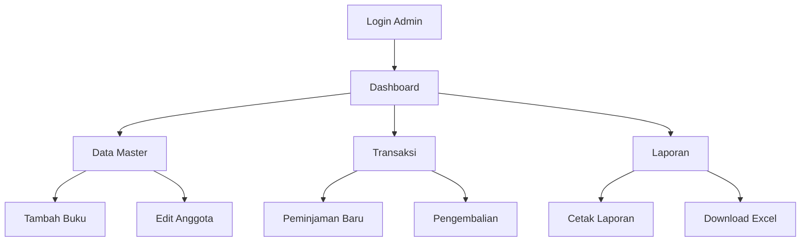
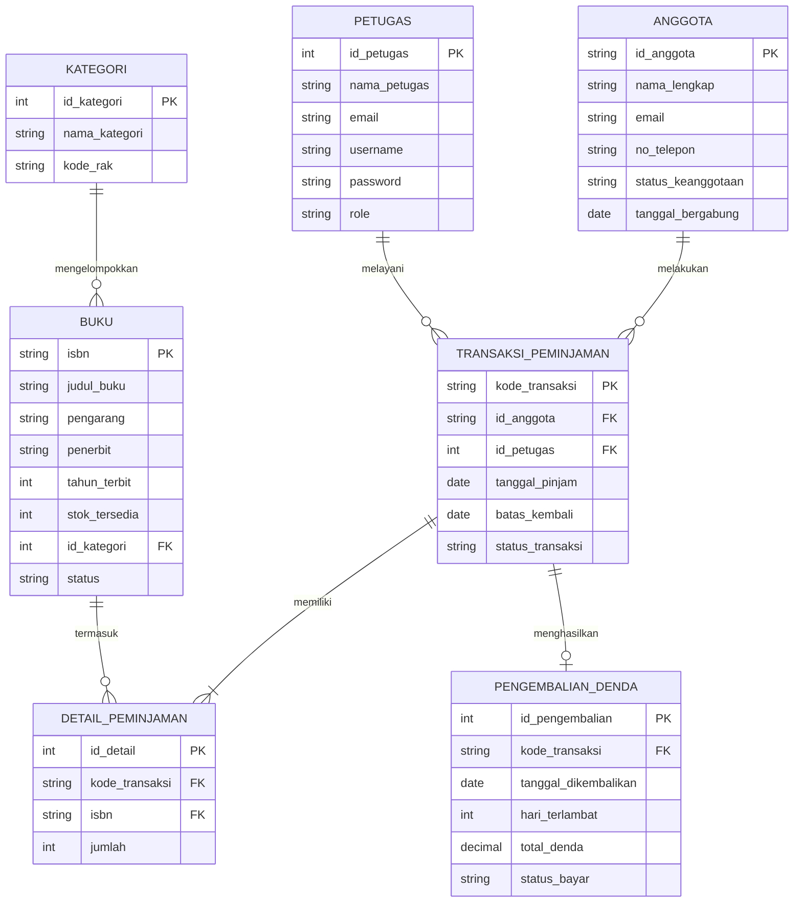

# PERANCANGAN E-LIBRARY SYSTEM

## 1. Latar Belakang
Sistem informasi perpustakaan digital (E-Library) dirancang untuk mengelola katalog buku, anggota, transaksi peminjaman, pengembalian, denda, dan laporan aktivitas perpustakaan secara terpadu. Sistem ini dibuat untuk mendukung kebutuhan admin perpustakaan dalam memantau ketersediaan koleksi, data anggota, serta rekap keaktifan peminjaman secara real time.

---

## 2. Hirarki Menu Aplikasi

### Sidebar / Navbar Admin
- Dashboard
  - Ringkasan KPI
  - Grafik peminjaman dan pengembalian
  - Aktivitas terbaru
- Data Master
  - Buku
  - Anggota
  - Kategori
  - Petugas
- Transaksi
  - Peminjaman
  - Pengembalian
  - Denda
- Laporan
  - Rekap bulanan
  - Statistik kategori
  - Export PDF
- Pengaturan
  - Role akses
  - Konfigurasi denda
  - Pengaturan sistem

### Alur pengguna utama


---

## 3. ER-D Sederhana



---

## 4. UI Wireframing dan Prototyping

### Link publik Figma
https://www.figma.com/design/ELibraryAdminDashboard/Perpustakaan-Digital?node-id=1%3A2

### Link publik Stitch
https://stitch.withgoogle.com/projects/10234-library-admin

### Screenshot / embed rancangan


---

## 5. Design System Awal

### Palette warna
- Primary: #0F172A
- Primary Accent: #2563EB
- Secondary: #14B8A6
- Warning: #F59E0B
- Neutral Background: #F8FAFC
- Surface: #FFFFFF
- Text Primary: #0F172A
- Text Secondary: #475569

### Typography
- Heading: Inter / Plus Jakarta Sans
- Body: Inter
- Size: 12, 14, 16, 20, 24, 32

### Komponen reusable
- Button Primary
- Button Secondary
- Input Field
- Search Box
- Card Stat
- Table Row Action
- Modal Konfirmasi

---

## 6. Struktur Folder Proyek
```text
stitch_digital_library_information_system/
├── PERANCANGAN.md
├── docs/
│   └── PERANCANGAN.md
├── assets/
│   ├── css/
│   │   └── style.css
│   ├── js/
│   │   ├── main.js
│   │   ├── dashboard.js
│   │   ├── data-master.js
│   │   ├── form.js
│   │   └── laporan.js
│   └── img/
│       ├── wireframe-dashboard.svg
│       └── design-system.svg
├── pages/
│   ├── dashboard.html
│   ├── data-master.html
│   ├── form.html
│   ├── laporan.html
│   └── layout.html
├── index.html
└── README.md
```

---

## 7. Rencana Milestone

### Milestone 1 (Pekan ke-3)
- Menyusun perencanaan menu
- Membuat ER-D menggunakan Mermaid
- Menyusun design system awal
- Membuat prototipe UI admin

### Milestone 2 (Pekan ke-5)
- Melakukan slicing layout admin
- Menerjemahkan design ke HTML/CSS
- Membuat template dasar admin panel

### Milestone 3 (Pekan ke-7)
- Menyusun halaman dashboard, data table, form, dan laporan
- Menambahkan interaktivitas JavaScript
- Menyiapkan UI yang siap ditampilkan di browser

---

## 8. Catatan
Dokumen ini merupakan versi perencanaan awal yang dapat dikembangkan lebih lanjut saat proses slicing dan implementasi halaman web berlangsung.
