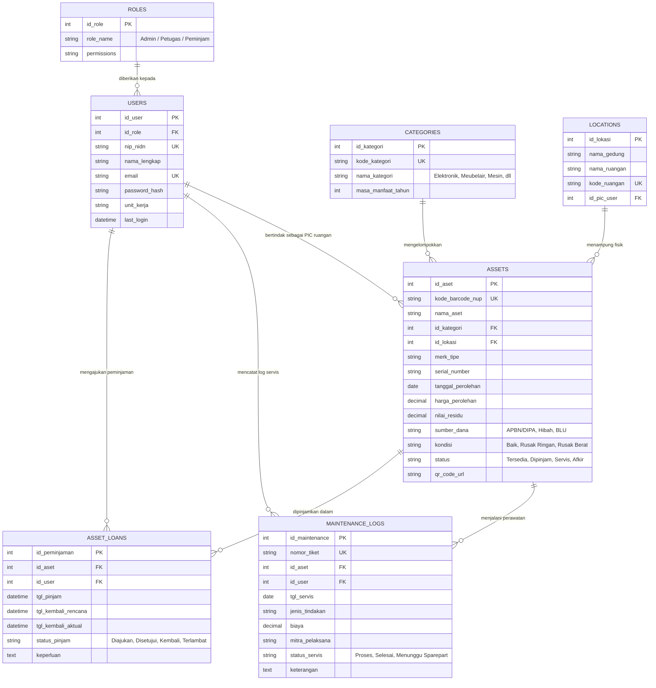

# PERANCANGAN SISTEM INFORMASI MANAJEMEN SARANA DAN PRASARANA (SIM-ASET)
**Mata Kuliah / Tugas Proyek:** Perancangan Antarmuka & Web Development  
**Topik:** #2 Sistem Manajemen Sarana dan Prasarana (Asset Management)  
**Target Platform:** Desktop Web (Admin Panel / Management Dashboard)  

---

## 1. Deskripsi & Ruang Lingkup Sistem
Sistem Informasi Manajemen Sarana dan Prasarana (SIM-ASET) dirancang untuk mempermudah inventarisasi, sirkulasi peminjaman, pelacakan kondisi/pemeliharaan (*maintenance*), kalkulasi depresiasi nilai buku, serta audit kepatuhan Barang Milik Negara (BMN) / aset institusi secara terpusat dan terintegrasi.

### Fitur Utama Sistem:
1. **Portal Autentikasi & Multi-Role Access (`index.html`)**: Gerbang masuk terenkripsi dengan pemisahan peran (*Petugas/Admin* vs *Peminjam Unit/Lab*), dukungan NIP/NIDN/Email institusi, serta integrasi Single Sign-On (SSO Kampus).
2. **Ringkasan Eksekutif & Monitoring Sarpras (`dashboard.html`)**: Visualisasi analitik metrik aset, rasio kelayakan fisik, grafik sebaran kategori, donut chart utilisasi ruangan/sirkulasi, serta alert prioritas servis preventif.
3. **Data Master Sarpras & Inventarisasi (`data-master.html`)**: Manajemen katalog inventaris terpadu berbasis penomoran Barcode/NUP, multi-filtering (kategori, lokasi gedung, kondisi fisik, status ketersediaan), pencarian cepat, cetak label, dan ekspor data tabular.
4. **Formulir Registrasi & Pengadaan Aset (`form.html`)**: Formulir bertingkat terstruktur (*stepper workflow*) untuk identitas aset, penempatan ruangan & PIC penanggung jawab, metode perolehan & kalkulasi depresiasi garis lurus, upload bukti BAST/foto fisik, serta live preview label cetak QR Code/Barcode.
5. **Laporan Riwayat Pemeliharaan & Audit Fisik (`laporan.html`)**: Rekapitulasi log pengerjaan servis, monitoring indeks kelayakan fisik sarpras (94.2%), realisasi anggaran DIPA/RKA-KL, dan Berita Acara Pemeriksaan Fisik & Pengesahan (BAP-P) berstandar akreditasi dan LAKIP yang siap cetak/ekspor PDF.

---

## 2. Hirarki Menu & Arsitektur Navigasi (Information Architecture)

```
[PORTAL SIM-ASET KAMPUS]
│
├── 🔑 0. Portal Akses & Autentikasi (index.html)
│   ├── Login Administrator / Petugas Sarpras (NIP/NIDN & Password)
│   ├── Login Peminjam Lab / Unit Kerja
│   ├── Integrasi Single Sign-On (SSO Akun Kampus)
│   └── Layanan Bantuan / Helpdesk TIK
│
└── 🖥️ SIM-ASET Admin Workspace (Persistent App Shell)
    ├── 1. 📊 Dashboard Utama (dashboard.html)
    │   ├── Ringkasan Metrik (Total Aset, Kondisi Prima, Servis, Usulan Hapus)
    │   ├── Grafik Distribusi Kategori & Kondisi Aset
    │   ├── Diagram Utilisasi Operasional (Standby, Dipinjam, Dalam Servis)
    │   ├── Alert Jadwal Servis & Perawatan Rutin Prioritas
    │   └── Log Aktivitas Mutasi Terakhir
    │
    ├── 2. 📦 Data Master Sarpras (data-master.html)
    │   ├── Tabel Inventaris Terpadu (Kode Barcode/NUP, Merk, Lokasi, Nilai Buku)
    │   ├── Filter Cepat (Kategori, Gedung/Ruang, Kondisi Fisik, Status Operasional)
    │   ├── Aksi Cepat (Cetak Label Barcode/QR, Export Excel, Detail & Mutasi)
    │   └── Aksi Tambah Aset Baru [-> form.html]
    │
    ├── 3. 📝 Formulir Registrasi Aset Baru (form.html)
    │   ├── Seksi 1: Detail Informasi Aset & Kodefikasi Sistem
    │   ├── Seksi 2: Alokasi Penempatan Gedung, Ruangan & PIC
    │   ├── Seksi 3: Pengadaan, Sumber Dana & Perhitungan Depresiasi Otomatis
    │   ├── Seksi 4: Lampiran Bukti Fisik & Dokumen Pembelian (BAST/Faktur)
    │   └── Panel Samping: Live Preview Label QR Code & Proyeksi Garis Lurus
    │
    ├── 4. 📑 Laporan & Log Pemeliharaan (laporan.html)
    │   ├── Kartu Indikator KPI Servis, Realisasi Anggaran & Indeks Kelayakan
    │   ├── Log Riwayat Tindakan Servis & Vendor Mitra Pelaksana
    │   └── Format Dokumen Resmi BAP-P (Berita Acara Pemeriksaan Fisik) Siap Cetak
    │
    ├── 5. 🔄 Sirkulasi & Peminjaman (Menu Navigasi Shell)
    │   ├── Peminjaman Aktif
    │   └── Riwayat Pengembalian & Berita Acara
    │
    └── 6. ⚙️ Pengaturan Sistem (Menu Navigasi Shell)
        ├── Manajemen Hak Akses Pengguna & Operator
        └── Konfigurasi Node & Notifikasi Audit
```

---

## 3. Konsep ER-D Sederhana (Entity Relationship Diagram)



---

## 4. Rincian Implementasi Antarmuka (7 Halaman Utama)

| File | Nama Halaman | Fungsi & Interaktivitas Utama |
|---|---|---|
| `index.html` | **Portal Akses & Login SIM-ASET** | Segmented tab switch peran (*Admin* vs *Peminjam*), toggle show/hide kata sandi, remember me, integrasi tombol SSO Google Institusi, validasi form kredensial. |
| `pages/dashboard.html` | **Dashboard Monitoring & Analitik** | 4 Kartu KPI metrik real-time, visual chart breakdown kategori & donut status operasional, jadwal alert perbaikan pekan ini, quick action servis. |
| `pages/data-master.html` | **Katalog Data Master Sarpras** | Master table inventaris dengan badge status warna, filter dinamis (Kategori, Gedung, Kondisi, Status), live text search, tombol ekspor & cetak barcode. |
| `pages/form.html` | **Form Registrasi & Pengadaan Aset** | Stepper form 4 tahap, auto-code generator NUP, kalkulator otomatis depresiasi garis lurus, upload bukti BAST drag-and-drop, real-time live preview stiker QR Code. |
| `pages/laporan.html` | **Laporan Riwayat Pemeliharaan & Audit** | Log kronologis tindakan servis, ringkasan realisasi biaya vs plafon DIPA, format resmi BAP-P siap cetak (*print-friendly stylesheet*). |
| `pages/sirkulasi.html` | **Sirkulasi & Peminjaman** | Pencatatan transaksi peminjaman dan pengembalian dengan sinkronisasi status aset. |
| `pages/pengaturan.html` | **Pengaturan Sistem** | Preferensi operator dan notifikasi serta pengelolaan data demo lokal. |

---

## 5. Struktur Direktori Proyek Pengumpulan (Repository Git)

```text
sim-aset-management/
├── docs/
│   ├── perancangan.md               <-- Dokumen Perencanaan (Milestone 1)
│   └── design-system.md             <-- Token dan panduan desain Stitch
├── assets/
│   ├── css/
│   │   └── app.css                  <-- Styling bersama dan aturan cetak
│   ├── js/
│   │   └── app.js                   <-- State lokal, navigasi dan interaktivitas halaman
│   └── img/
│       └── stitch-*.png             <-- Referensi screenshot rancangan
├── pages/
│   ├── dashboard.html              <-- Halaman Dashboard Eksekutif
│   ├── data-master.html            <-- Halaman Tabel Data Master Aset
│   ├── form.html                   <-- Halaman Form Registrasi Aset Baru
│   ├── laporan.html                <-- Halaman Laporan & Berita Acara Servis
│   ├── sirkulasi.html              <-- Halaman Peminjaman dan Pengembalian
│   └── pengaturan.html             <-- Halaman Preferensi Sistem
└── index.html                      <-- Halaman Login Portal SIM-ASET
```

---

## 6. Design System & Token Visual

* **Primary Palette**: Enterprise Cobalt (`#2563EB`), Navy Deep (`#1E293B`), Surface Soft Tint (`#F8F9FF`).
* **Semantic Status Indicators**:
  * 🟢 **Hijau (Emerald / `#16A34A`)**: Kondisi Baik / Tersedia / Selesai / Terverifikasi.
  * 🟡 **Amber / Kuning (`#D97706`)**: Rusak Ringan / Dalam Servis / Perlu Perhatian.
  * 🔴 **Merah (Rose / `#DC2626`)**: Rusak Berat / Afkir / Usulan Penghapusan / Kritis.
* **Tipografi**: `Plus Jakarta Sans` dengan format angka tabular monospaced untuk kode aset (NUP) dan kalkulasi mata uang Rupiah (IDR).
