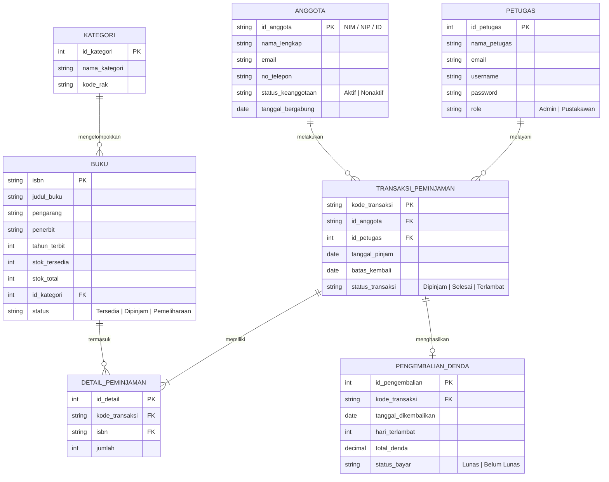

# PERANCANGAN SISTEM INFORMASI PERPUSTAKAAN DIGITAL (E-LIBRARY)
**Dokumentasi Milestone 1 - Perencanaan Menu, ER-D, dan Arsitektur UI**

---

## 1. Ringkasan Proyek
Sistem Informasi Perpustakaan Digital (**E-Library**) adalah aplikasi berbasis web yang dirancang untuk mengelola sirkulasi buku digital & fisik, katalog buku, keanggotaan (mahasiswa/dosen/umum), peminjaman, pengembalian, denda keterlambatan, serta pelaporan statistik literasi secara terpadu dan efisien.

---

## 2. Struktur & Hirarki Menu (Navigation Map)

### A. Sidebar Navigation (Admin Panel)
- **Dashboard (`/pages/dashboard.html`)**
  - KPI Stat Cards: Total Koleksi Buku, Total Anggota Aktif, Peminjaman Berjalan, Denda Belum Lunas
  - Tren Sirkulasi Bulanan (Chart.js Line & Bar Chart)
  - Distribusi Kategori Buku (Doughnut Chart)
  - Notifikasi Jatuh Tempo & Quick Activity Log
- **Katalog & Data Master (`/pages/data-master.html`)**
  - Data Buku & E-Book (ISBN, Judul, Pengarang, Penerbit, Stok, Kategori, Status)
  - Kategori & Rak Buku (Dewey Decimal Classification / DDC)
  - Data Anggota / Member (NIM/NIDN, Nama, Program Studi, Status Keaktifan)
  - Data Petugas Perpustakaan
- **Sirkulasi & Transaksi (`/pages/form.html`)**
  - Form Peminjaman Baru (Scan Barcode / Input NIM & ID Buku)
  - Form Pengembalian & Hitung Denda Otomatis
  - Riwayat & Status Reservasi Buku
- **Laporan & Analitik (`/pages/laporan.html`)**
  - Laporan Sirkulasi Harian / Bulanan
  - Rekap Buku Paling Sering Dipinjam (Top 10)
  - Rekap Denda & Pembayaran
  - Export PDF / Excel & Print Friendly View
- **Pengaturan & Manajemen Sistem**
  - Konfigurasi Batas Pinjam & Tarif Denda / Hari
  - Manajemen Akun & Hak Akses (Role-based)

---

## 3. Entity Relationship Diagram (ER-D) Sederhana

Berikut adalah diagram relasi entitas menggunakan sintaks **Mermaid.js**:



---

## 4. Rencana Arsitektur & Slicing (Milestone 2 & 3)

### Struktur Folder Proyek
```text
elibrary-system/
├── docs/
│   └── perancangan.md            # Dokumentasi Milestone 1
├── assets/
│   ├── css/
│   │   ├── tailwind.min.css      # Framework Utility CSS
│   │   └── custom.css            # Custom Styling & Print Media
│   ├── js/
│   │   ├── main.js               # Toggle Sidebar, Modal, Global Helpers
│   │   ├── dashboard.js          # Inisialisasi Chart.js & Mock KPI
│   │   ├── master-data.js        # DOM Search, Filter & CRUD Mocking
│   │   └── validation.js         # Validasi Form Transaksi & Denda
│   └── img/
│       ├── logo-library.svg
│       └── covers/
├── pages/
│   ├── dashboard.html            # Halaman Dashboard + Visualisasi Grafik
│   ├── data-master.html          # Tabel Master Buku + Modal CRUD
│   ├── form.html                 # Form Transaksi Peminjaman & Validasi
│   └── laporan.html              # Laporan & Cetak Rekapitulasi
├── layout.html                   # Master Shell (Sidebar, Header, Main, Footer)
└── index.html                    # Halaman Login Admin / Gerbang Utama
```

---

## 5. Mockup & Wireframe Design (Stitch & Figma Links)
- **Figma Design System & Hi-Fi UI Link**: `https://www.figma.com/design/sample-elibrary-system`
- **Design Tokens**:
  - Primary Color: Deep Emerald Indigo (`#1E3A8A` / `#0D9488`)
  - Accent / Warning: Amber Gold (`#F59E0B`)
  - Surface Background: Neutral Gray Slate (`#F8FAFC` / `#FFFFFF`)
  - Typography: Inter & Plus Jakarta Sans
